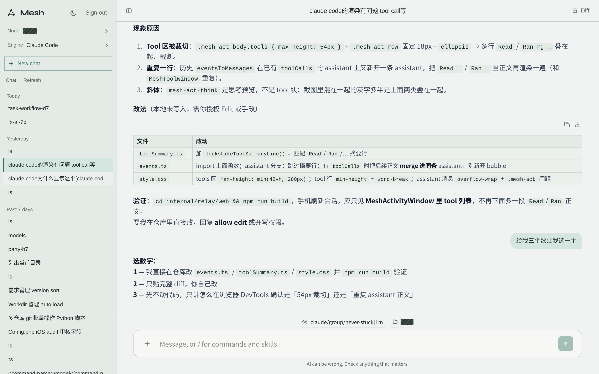
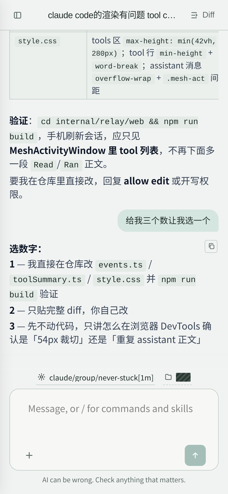
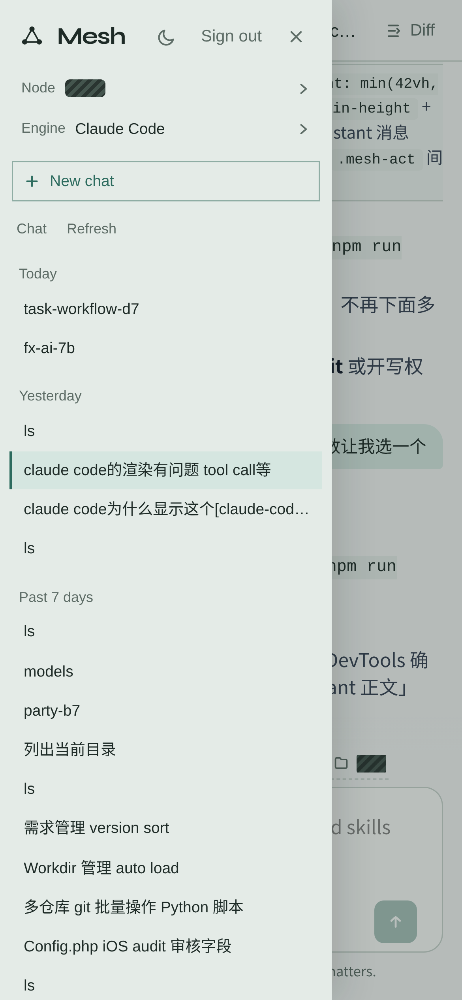

# Agent Mesh

### Every local coding agent. One session mesh.

**Claude Code, Cursor, Codex, OpenCode, Pi, WorkBuddy, Qoder CN — one chat.**
A node runs next to the engines. A relay only routes. The web UI and the desktop app share the same protocol, with end-to-end encryption the relay cannot read.


**[Install](#quick-start)** · **[Docs](AGENTS.md)** · **English** · [简体中文](README.zh-CN.md)

<p align="center">
  
</p>
<p align="center">
  
  &nbsp;&nbsp;
  
</p>

<p align="center"><sub>Desktop and phone. Node names and working directories are redacted.</sub></p>

## Is Agent Mesh for you?

Each coding agent keeps its own sessions, in its own files, on the machine where it runs. Opening three windows to resume three chats does not scale. Agent Mesh puts them behind one catalog:

- **Pick any engine on any node** from one list. The node talks to the real local CLI; the relay never decrypts the transcript.
- **Use one OpenAI-compatible URL** for every engine: `/v1/models` and `/v1/chat/completions` on the node and on the relay.
- **Stay on the machine that has the tools**: git, files, and engine sockets stay local. The public relay only forwards envelopes and a read-only catalog.
- **Chat from a browser or a desktop window** against the same sessions.

It is for you if you run more than one coding agent, or agents on more than one machine. If you only use one vendor's own app, you do not need it.

## Quick start

**1 · Install.** From a clone:

```sh
git clone https://github.com/deliangyang/agent-mesh.git
cd agent-mesh
./scripts/setup.sh
```

`setup.sh` checks Go 1.25 and Node 20, builds `node` / `relay` / `ctl`, writes `~/.agent-mesh`, and generates identity keys.

Or install a GitHub Release binary:

```sh
curl -fsSL https://raw.githubusercontent.com/deliangyang/agent-mesh/main/scripts/install.sh | sh
```

Remove what the script installed with `curl -fsSL …/install.sh | sh -s -- --uninstall`. Keys in `~/.agent-mesh` stay unless you add `--purge`.

**2 · Start the relay** (password required for the web UI):

```sh
MESH_PASSWORD=change-me ./bin/relay -listen 0.0.0.0:8443 -web
```

**3 · Start a node** on a machine that has the engines:

```sh
./bin/node -listen 127.0.0.1:7700 -relay http://127.0.0.1:8443
```

Open `http://127.0.0.1:8443`, sign in with the password, pick a node, an engine, a model, and a workspace.

From the terminal:

```sh
./bin/ctl keygen
./bin/ctl nodes --relay http://127.0.0.1:8443
./bin/ctl list --direct http://127.0.0.1:7700 --engine claude
./bin/ctl send "list the files in this repo" --engine cursor --cwd "$PWD" --direct http://127.0.0.1:7700
```

Environment: `MESH_RELAY` `MESH_DIRECT` `MESH_NODE` `MESH_PASSWORD` `MESH_ADVERTISE`. Engine binaries can be overridden with `CURSOR_AGENT_BIN`, `QODERCN_BIN`, and similar.

## Supported engines

Claude Code · Cursor Agent · Codex · OpenCode · Pi · WorkBuddy · Qoder CN

The node only lists engines installed on that machine. Anything that speaks OpenAI chat completions can also call the node or relay:

```sh
export OPENAI_BASE_URL=http://127.0.0.1:7700/v1
export OPENAI_API_KEY=mesh
```

## How it fits together

```
┌─────────────┐     encrypted RPC      ┌─────────────┐
│  web / ctl  │ ─────────────────────► │    node     │ ── local CLIs
│  desktop    │                        │  :7700      │     claude / agent / …
└──────┬──────┘                        └──────▲──────┘
       │  HTTPS / WS                          │ reverse tunnel
       ▼                                      │
┌─────────────┐     Envelope From/To   catalog snapshot
│    relay    │ ─────────────────────► (relay cannot decrypt Ciphertext)
│  :8443 -web │
└─────────────┘
```

The relay at `:8443` serves the Vue chat UI, the node directory, and encrypted envelopes. The node at `:7700` speaks the same OpenAI surface and drives the engines.

## What it does

### Any engine, one chat

The sidebar lists nodes, engines, and sessions. A new chat is a `send`; an existing thread is a `reply`. Follow-ups queue on the node while a turn is still running. Ask cards and permission prompts stay in the composer.

### Privacy boundary

The relay routes `From` / `To` only. Application payloads are sealed with Ed25519 + X25519. Direct mode (`--direct`) skips the relay and still uses the same encryption. Keys live in `~/.agent-mesh/` at mode 0600.

### OpenAI-compatible API

Both node and relay expose `/v1/models` and `/v1/chat/completions`, plus `/v1/openai/*` for sessions, history, stream, directories, commands, followups, choice, and git.

### Desktop and headless

`make desktop` builds a Wails window around the local node. `-headless` runs the node HTTP server without a window. Linux machines without `DISPLAY` / `WAYLAND_DISPLAY` fall back to headless automatically.

## Build from source

```sh
make setup         # toolchain + build + ~/.agent-mesh
make test          # Go tests (except desktop) + web tests
make node relay ctl
make dist          # dist/agent-mesh_<ver>_<os>_<arch>.tar.gz
make supervisor    # generate and restart a local supervisord unit
```

Docker:

```sh
docker build -t agent-mesh-relay .
docker run --rm -p 8443:8443 -e MESH_PASSWORD=change-me agent-mesh-relay -listen 0.0.0.0:8443 -web
```

CI builds and tests on every push. A `v*` tag publishes release archives from `.github/workflows/release.yml`.

## Configuration

| | |
| :--- | :--- |
| `~/.agent-mesh/node.key` | node identity |
| `~/.agent-mesh/client.key` | CLI identity |
| `~/.agent-mesh/node.env` | `MESH_PASSWORD`, `MESH_RELAY`, listen flags |
| `~/.agent-mesh/followups` | queued follow-up messages |
| `deploy/supervisor` | sample supervisord unit; `scripts/setup.sh --supervisor` fills paths |

Do not commit keys, `.env`, or supervisor passwords.

## License

[MIT](LICENSE)
