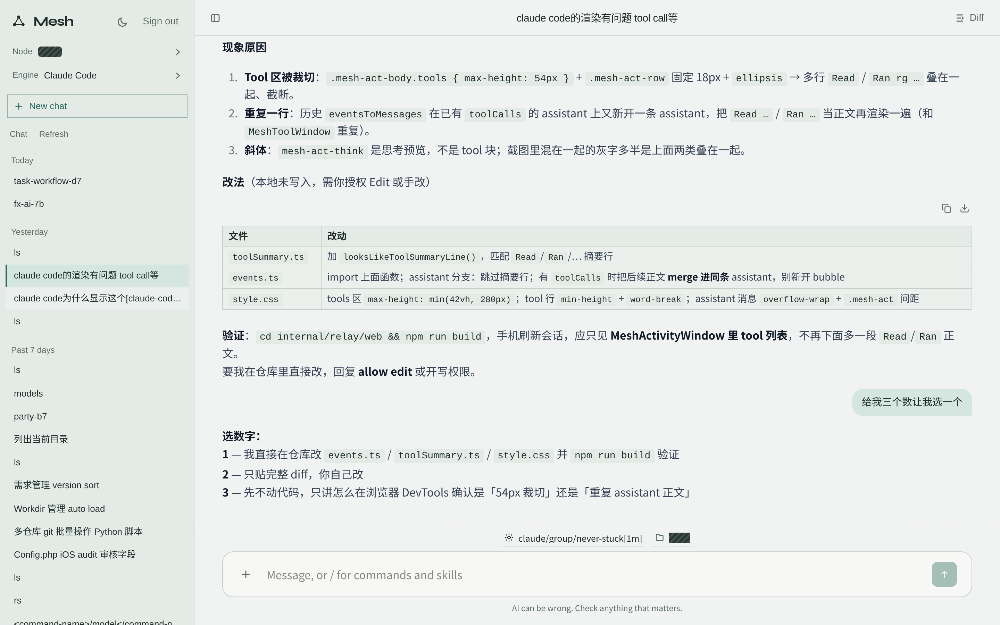
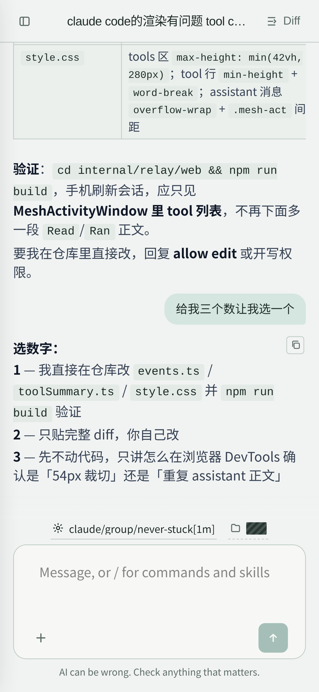
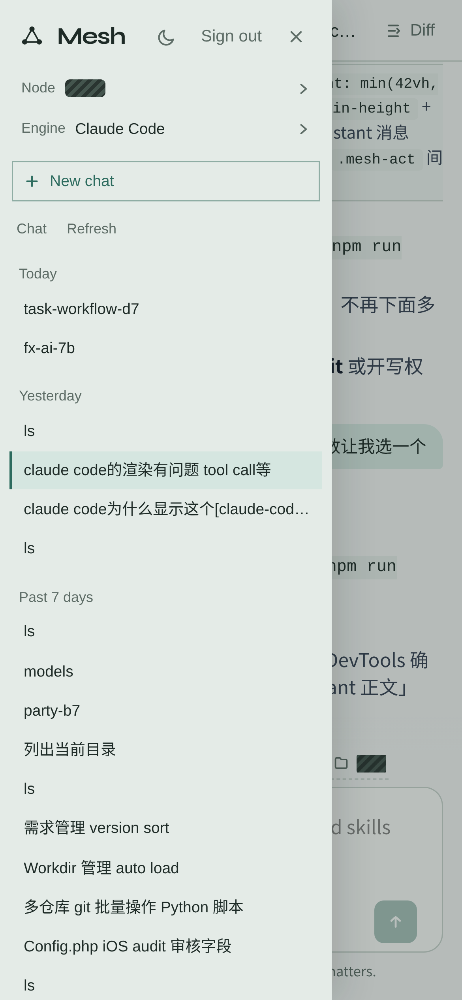

# Agent Mesh

### 本机每一种 coding agent，一张会话网。

**Claude Code、Cursor、Codex、OpenCode、Pi、WorkBuddy、Qoder CN，一个对话入口。**
节点跑在装引擎的机器上，中继只做路由。网页和桌面客户端走同一套协议，端到端加密，中继解不开会话明文。


**[安装](#快速开始)** · **[Windows](docs/windows.zh-CN.md)** · **[macOS](docs/macos.zh-CN.md)** · **[文档](AGENTS.md)** · [English](README.md) · **简体中文**

<p align="center">
  
</p>
<p align="center">
  
  &nbsp;&nbsp;
  
</p>

<p align="center"><sub>电脑端和手机端。节点名和工作目录已打码。</sub></p>

## Agent Mesh 适合你吗？

每种 coding agent 都把会话写在自己的文件里，只在装它的那台机器上。开三个窗口去续三个对话，撑不久。Agent Mesh 把它们收进一份目录：

- **任意节点上的任意引擎**，在一张表里选。节点驱动本机真正的 CLI；中继从不解密对话。
- **一个 OpenAI 兼容地址通吃**：节点和中继都挂 `/v1/models` 和 `/v1/chat/completions`。
- **工具留在有它们的那台机器上**：git、文件、引擎套接字都在本地。公网中继只转发信封和只读目录。
- **浏览器或桌面窗口**对着同一批会话聊。

如果你用不止一种 coding agent，或引擎散落在不止一台机器上，它就适合你。如果只用一家厂商自己的应用，就不需要它。

## 快速开始

**1 · 安装。** 从源码：

```sh
git clone https://github.com/deliangyang/agent-mesh.git
cd agent-mesh
./scripts/setup.sh
```

`setup.sh` 会检查 Go 1.25 和 Node 20，编译 `node` / `relay` / `ctl`，写入 `~/.agent-mesh`，并生成身份密钥。

也可以安装 GitHub Release 里的二进制。中继和节点分开装：公网机器不必跑引擎，笔记本不必对外提供网页。

中继（写入 `~/.agent-mesh/relay.env`，并打开开机自启）：

```sh
curl -fsSL https://raw.githubusercontent.com/deliangyang/agent-mesh/main/scripts/install-relay.sh | sh
```

节点（写入 `~/.agent-mesh/node.env`，开机自启，并加上桌面启动入口）：

```sh
curl -fsSL https://raw.githubusercontent.com/deliangyang/agent-mesh/main/scripts/install-node.sh | sh -s -- --relay https://mesh.example.com
```

Linux 会安装 systemd 单元并 `enable --now`。macOS 会安装 launchd 配置（`RunAtLoad` + `KeepAlive`）。图形界面会再写 Linux 的 `.desktop` 或 macOS 的 `Agent Mesh.app`。字符界面（SSH 且没有 `DISPLAY` / `WAYLAND_DISPLAY`）自动按 **headless** 装，并提示填写或修改中继地址（`MESH_RELAY`）；直接回车保留当前值，以后也可改 `~/.agent-mesh/node.env`。可用 `--headless` / `--desktop` 强制模式。不需要开机服务时加 `--no-service`。

**Windows 节点：** 没有 `install-node.sh`。下 Release zip（或 `make node-windows`），按 **[Windows 部署](docs/windows.zh-CN.md)** 做。双击 `mesh-node.exe` 进托盘；要挂中继就在快捷方式里加 `-relay`。

**macOS 节点：** 用 `install-node.sh`（launchd + 可选 `Agent Mesh.app`）。细节见 **[macOS 部署](docs/macos.zh-CN.md)**。

如果 GitHub Release 下载不了（国内部分网络常见），加镜像前缀：

```sh
AGENT_MESH_MIRROR=https://ghfast.top curl -fsSL …/install-relay.sh | sh
```

卸载用 `curl -fsSL …/install-relay.sh | sh -s -- --uninstall`（节点换成 `install-node.sh`）。`~/.agent-mesh` 里的密钥会保留，加 `--purge` 才会删掉。

一行安装要先有 `v*` 标签对应的 GitHub Release。在此之前，若机器上有 Go 1.25+ 和 Node 20+，脚本会退回克隆源码再编译。

**2 · 启动中继**（网页必须设密码）。`install-relay.sh` 装完服务已经在跑；从源码构建时：

```sh
MESH_PASSWORD=change-me ./bin/relay -listen 0.0.0.0:8443 -web
```

**3 · 在装有引擎的机器上启动节点。** `install-node.sh` 装完服务已经在跑；从源码构建时：

```sh
./bin/node -listen 127.0.0.1:7700 -relay http://127.0.0.1:8443
```

打开 `http://127.0.0.1:8443`，用密码登录，选节点、引擎、模型和工作目录。

也可以全程在终端里：

```sh
./bin/ctl keygen
./bin/ctl nodes --relay http://127.0.0.1:8443
./bin/ctl list --direct http://127.0.0.1:7700 --engine claude
./bin/ctl send "list the files in this repo" --engine cursor --cwd "$PWD" --direct http://127.0.0.1:7700
```

环境变量：`MESH_RELAY` `MESH_DIRECT` `MESH_NODE` `MESH_PASSWORD` `MESH_ADVERTISE`。引擎二进制可用 `CURSOR_AGENT_BIN`、`QODERCN_BIN` 等覆盖。

## 支持的引擎

Claude Code · Cursor Agent · Codex · OpenCode · Pi · WorkBuddy · Qoder CN

节点只列出这台机器上装了的引擎。Windows 上会从 `PATH`、`%USERPROFILE%\.local\bin` 和 `%APPDATA%\npm` 查找（含 `.exe` / `.cmd`）。zip 安装、托盘和开机自启见 **[Windows 部署](docs/windows.zh-CN.md)**。任何能填 OpenAI chat completions 的工具也可以打节点或中继：

```sh
export OPENAI_BASE_URL=http://127.0.0.1:7700/v1
export OPENAI_API_KEY=mesh
```

## 整体结构

```
┌─────────────┐     encrypted RPC      ┌─────────────┐
│  web / ctl  │ ─────────────────────► │    node     │ ── local CLIs
│  desktop    │                        │  :7700      │     claude / agent / …
└──────┬──────┘                        └──────▲──────┘
       │  HTTPS / WS                          │ reverse tunnel
       ▼                                      │
┌─────────────┐     Envelope From/To   catalog snapshot
│    relay    │ ─────────────────────► (relay cannot decrypt Ciphertext)
│  :8443 -web │
└─────────────┘
```

`:8443` 上的中继提供 Vue 对话界面、节点目录和加密信封。`:7700` 上的节点挂同一套 OpenAI 接口，并驱动本机引擎。

## 功能

### 任意引擎，一个对话

侧栏列出节点、引擎和会话。新对话是 `send`，已有线程是 `reply`。当前轮还在跑时，追加消息会在节点上排队。Ask 卡和权限确认留在输入区。

### 信任边界

- **ctl / Envelope RPC**：中继只路由 `From` / `To`，不解 `Ciphertext`。应用层 Ed25519 + X25519。`--direct` 不走中继，加密相同。
- **经中继的 Web UI**：浏览器持有口令封装的 `client.key`，对话走同一套 Envelope；中继不聚合明文 history/ingest，目录快照不含会话路径与正文。
- **本机 node / desktop UI**：仍用明文 OpenAI 兼容面（localhost 信任）。
- 密钥在 `~/.agent-mesh/`（0600）；浏览器密钥匣在 IndexedDB。

### OpenAI 兼容接口

节点和中继仍提供 `/v1/models` 和 `/v1/chat/completions`，以及 `/v1/openai/*`（给外部工具与本机 UI）。经中继的 Web 对话改走 Envelope RPC，不再依赖明文 history/ingest。

### 桌面和无窗口

`make desktop` 编译本机客户端：默认用 Chrome/Edge 应用窗口打开与中继同一套 Vue（`internal/relay/web`，无 CGO）。`make desktop-windows` / `make desktop-linux` 则链接 Wails 原生壳（WebView2 / WebKitGTK），再导航到本机节点地址（Wails AssetServer 不支持 WebSocket）。节点自己提供界面和 `/v1`，网页操作不依赖中继。`-headless` 只跑节点 HTTP。Linux 上没有 `DISPLAY` / `WAYLAND_DISPLAY` 时会自动改走无窗口。

## 从源码构建

```sh
make setup         # 工具链 + 编译 + ~/.agent-mesh
make test          # Go 测试（排除 desktop）+ 网页测试
make node relay ctl
make dist          # dist/agent-mesh-{relay,node}_<os>_<arch>.tar.gz（Windows 为 .zip）
make node-windows  # bin/mesh-node-windows-{amd64,arm64}.exe 以及 mesh-ctl-windows-*.exe
make supervisor    # 生成并重启本机 supervisord 单元
```

Docker：

```sh
docker build -t agent-mesh-relay .
docker run --rm -p 8443:8443 -e MESH_PASSWORD=change-me agent-mesh-relay -listen 0.0.0.0:8443 -web
```

每次推送都会跑构建和测试。打 `v*` 标签会按 `.github/workflows/release.yml` 发布产物。

## 配置

| | |
| :--- | :--- |
| `~/.agent-mesh/node.key` | 节点身份 |
| `~/.agent-mesh/client.key` | 命令行身份 |
| `~/.agent-mesh/node.env` | 节点服务：`MESH_PASSWORD`、`MESH_RELAY`、监听参数 |
| `~/.agent-mesh/relay.env` | 中继服务：`MESH_PASSWORD`、`MESH_LISTEN` |
| `~/.agent-mesh/followups` | 追加消息队列 |
| `%USERPROFILE%\.agent-mesh` | Windows 上同一套文件（`node.key`、`node.log`） |
| `deploy/systemd` | `install-relay.sh` / `install-node.sh` 写入的 systemd 单元 |
| `deploy/launchd` | 同样服务的 macOS launchd 配置 |
| `deploy/desktop` | 节点的 Linux `.desktop` 启动器 |
| `deploy/supervisor` | supervisord 样例；`scripts/setup.sh --supervisor` 会填路径 |

不要把密钥、`.env` 或 supervisor 里的密码提交进仓库。

## 许可证

[MIT](LICENSE)
